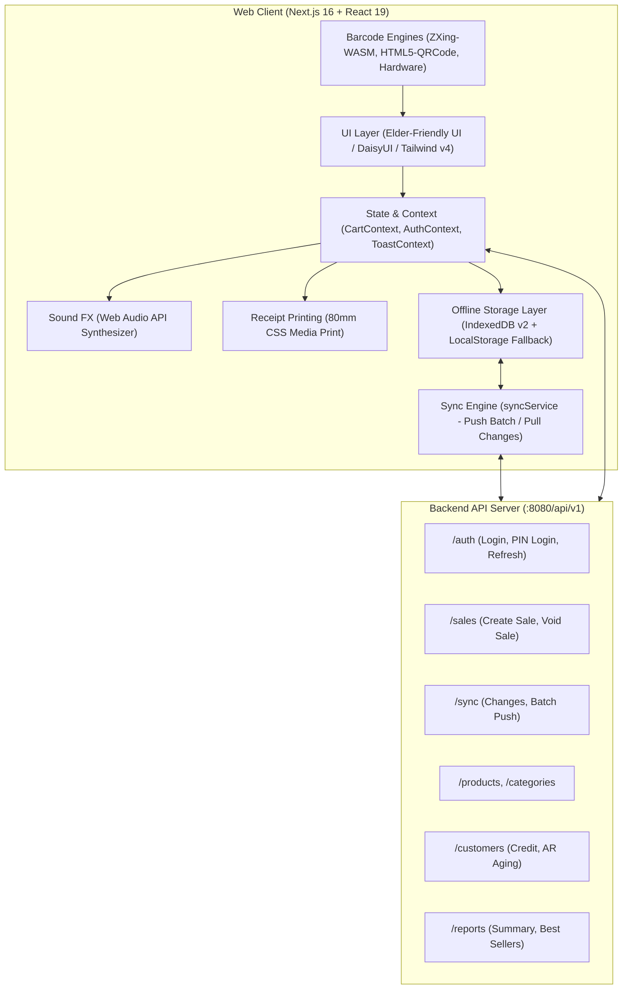

# ICE POS Web v2 (Point of Sale System)

ระบบขายหน้าร้าน (Point of Sale - POS) สำหรับธุรกิจจำหน่ายน้ำแข็งและสินค้าอุปโภคบริโภค ออกแบบพิเศษตามหลัก **Elder-Friendly UI/UX** เพื่อรองรับพนักงานแคชเชียร์ทุกวัย โดยเฉพาะผู้สูงอายุ ให้ใช้งานได้สะดวก รวดเร็ว ลดความผิดพลาด พร้อมสถาปัตยกรรม **Offline-First Synchronization** ที่สามารถขายสินค้าและพิมพ์ใบเสร็จได้อย่างต่อเนื่องแม้ไม่มีสัญญาณอินเทอร์เน็ต

---

## 🌟 จุดเด่นและระบบการทำงานหลัก (Key Features)

### 1. การออกแบบสำหรับผู้สูงอายุ (Elder-Friendly UI/UX)

- **Touch Target ขนาดใหญ่:** ปุ่มกดขนาด 48–64px ขึ้นไป ลดการกดผิดพลาด
- **Typography คมชัด:** ฟอนต์อ่านง่าย ขนาดตัวอักษร 18–36px คอนทราสต์สีผ่านมาตรฐาน WCAG 4.5:1
- **ปุ่มลัดธนบัตรด่วน & Smart Cash Suggestions:** คำนวณเงินทอนอัตโนมัติ พร้อมปุ่มลัดธนบัตรไทย (พอดีเงิน, 20, 50, 100, 500, 1,000 บาท)
- **ระบบเสียงแจ้งเตือน (Web Audio API Synthesizer):** เสียงบี๊บยืนยันการยิงสแกนสินค้า เพิ่มสินค้าในบิล และเสียงแจ้งเตือนเมื่อชำระเงินสำเร็จ
- **รองรับ Light / Dark Mode:** สลับโหมดสีได้ทันทีจาก Header Bar ด้านบน

### 2. ระบบแคชเชียร์ขายหน้าร้าน (Point of Sale Screen - `/`)

- **การขายต่อเนื่อง ไม่ติดสต็อก:** ขายได้ไหลลื่นไม่มีสะดุด ไม่บล็อกการขายกรณีสินค้าหมด
- **รองรับการสแกนบาร์โค้ดหลายรูปแบบ:**
  - ช่องสแกนบาร์โค้ด USB / Bluetooth แบบ Auto-focus พร้อมค้นหาด่วนด้วยชื่อ
  - สแกนผ่านกล้องมือถือ/แท็บเล็ตด้วย WebAssembly (`zxing-wasm`) และ `html5-qrcode`
- **การจัดการตะกร้าสินค้า (Cart):** ปรับจำนวนสินค้า เพิ่ม/ลด/ลบ พร้อมคำนวณยอดรวมสุทธิเรียลไทม์ (รองรับทั้ง Desktop Sidebar และ Mobile Drawer)
- **ประวัติบิลและการยกเลิกบิล (Sales History & Void Sale):** ดูบิลย้อนหลัง พิมพ์ใบเสร็จซ้ำ และยกเลิกบิลพร้อมระบุเหตุผลได้ทันที
- **สรุปยอดขายประจำวัน (Daily Summary Drawer):** ดูสรุปยอดรวม, จำนวนบิล, สัดส่วนเงินสด/เงินเชื่อ และบิลยกเลิกประจำวันได้ทันที

### 3. ระบบชำระเงิน (Checkout System)

รองรับวิธีการชำระเงิน 2 รูปแบบตาม API Contract:

1. **เงินสด (CASH):** แป้นตัวเลขขนาดใหญ่ (Numpad) พร้อมปุ่มลัดธนบัตร คำนวณเงินทอนอัตโนมัติ
2. **เงินเชื่อ (CREDIT):** เลือกลูกค้า ตรวจสอบวงเงินเครดิตคงเหลือ (รองรับการขายเงินเชื่อในโหมดออฟไลน์)

- **พิมพ์ใบเสร็จความร้อน 80 มม.:** พิมพ์ผ่านเบราว์เซอร์ (`window.print()`) ร่วมกับ CSS `@media print` แสดงผลชัดเจนทั้งออนไลน์และออฟไลน์

### 4. สถาปัตยกรรมทำงานออฟไลน์ (Offline-First Synchronization)

- **IndexedDB (`ice_pos_db` v2):** บันทึกแคตตาล็อกสินค้า, หมวดหมู่, ข้อมูลลูกค้า, ผู้ใช้งาน, รายการขายออฟไลน์ และข้อมูลลูกหนี้
- **Offline PIN Login:** เข้าใช้งานแคชเชียร์ได้แม้เน็ตหลุด ด้วยระบบตรวจสอบ PIN แฮช SHA-256 (Web Crypto API) ที่จัดเก็บบนเครื่อง
- **Auto Sync Push & Pull:** ตรวจจับสถานะเครือข่ายอัตโนมัติ ดึงข้อมูลล่าสุด (`GET /sync/changes`) และส่งบิลออฟไลน์ขึ้นเซิร์ฟเวอร์แบบ Batch (`POST /sync/batch`) เมื่ออินเทอร์เน็ตกลับมาทำงาน
- **PWA Service Worker:** แคชหน้าเว็บและ Assets จำเป็น สามารถเปิดใช้งานได้ตลอดเวลา

### 5. ระบบจัดการลูกค้าและลูกหนี้การค้า (Customers & AR Aging - `/customers`)

- **จัดการข้อมูลลูกค้า:** เพิ่ม/แก้ไขข้อมูลลูกค้า เบอร์โทรศัพท์ ที่อยู่ และวงเงินเครดิต
- **ระบบชำระหนี้ (Pay Credit):** บันทึกรับชำระหนี้เงินเชื่อ พร้อมประวัติการชำระ
- **ประวัติการใช้เครดิต (Credit History):** ตรวจสอบยอดซื้อเชื่อและยอดชำระย้อนหลัง
- **รายงานอายุลูกหนี้ (AR Aging Table):** วิเคราะห์หนี้ค้างชำระตามช่วงเวลา (Current, 1–30 วัน, 31–60 วัน, 61–90 วัน, มากกว่า 90 วัน)

### 6. ระบบจัดการแคตตาล็อกและสินค้า (Catalog Management - `/catalog`)

- **จัดการสินค้าและหมวดหมู่:** เพิ่ม แก้ไข ลบ กำหนดราคาทุน ราคาขาย หน่วยนับ และบาร์โค้ด
- **ระบบกล้องถ่ายภาพสินค้า:** ถ่ายภาพสินค้าจากกล้องของอุปกรณ์ (`CameraCaptureModal`) หรืออัปโหลดไฟล์รูปภาพ
- **เครื่องมือสแกนบาร์โค้ด:** สแกนบาร์โค้ดผ่านกล้องเพื่อกรอกข้อมูลสินค้าอัตโนมัติ

### 7. ระบบจัดการผู้ใช้งานและสิทธิ์ (User Management - `/users`)

- **จัดการผู้ใช้งาน:** เพิ่มและจัดการบัญชีผู้ใช้งาน พร้อมระบุบทบาท (`admin`, `cashier`)
- **จัดการรหัส Quick PIN:** กำหนดและรีเซ็ตรหัส PIN สำหรับการเข้าสู่ระบบด่วนหน้าร้าน
- **เปิด/ปิดสถานะผู้ใช้งาน (Active/Inactive)**

### 8. ระบบรายงานและสถิติการขาย (Reports & Analytics - `/reports`)

- **สรุปยอดขายรายวัน:** ยอดขายรวมสุทธิ, จำนวนบิล, ยอดเงินสด, ยอดเงินเชื่อ, และยอดบิลยกเลิก
- **สินค้าขายดี (Top Best Sellers):** จัดอันดับสินค้าขายดีตามยอดขายและจำนวนชิ้น
- **กรองข้อมูลตามวันที่:** เรียกดูย้อนหลังตามวันที่ที่ต้องการ

---

## 🏗️ สถาปัตยกรรมระบบ (System Architecture)



---

## 💰 กฎการคำนวณและแปลงหน่วยเงิน (Satang Integer Contract)

> **สำคัญ:** Backend API ของระบบจัดเก็บและรับส่งค่าเงินในหน่วย **สตางค์ (Satang - Integer)** ทั้งหมด เพื่อป้องกันปัญหา Floating-point precision

| ฟิลด์ใน API                | หน่วยใน API  | การแปลงเพื่อแสดงผลในหน้าจอ | ตัวอย่าง                          |
| :------------------------- | :----------- | :------------------------- | :-------------------------------- |
| `unit_price`, `cost_price` | สตางค์ (int) | `satang / 100`             | `5000` สตางค์ = `50.00 ฿`         |
| `tendered_amount`          | สตางค์ (int) | `Math.round(baht * 100)`   | รับเงิน 100 บาท ส่ง `10000`       |
| `change_amount`            | สตางค์ (int) | `change / 100`             | `5000` สตางค์ = เงินทอน `50.00 ฿` |
| `gross_total`, `net_total` | สตางค์ (int) | `total / 100`              | แสดงผลในบิลและรายงาน              |

---

## 🛠️ เทคโนโลยีที่ใช้ (Tech Stack)

| หมวดหมู่             | เทคโนโลยี / เครื่องมือ                      | รายละเอียด                                                     |
| :------------------- | :------------------------------------------ | :------------------------------------------------------------- |
| **Framework**        | Next.js 16 (App Router) + React 19          | สถาปัตยกรรม Server & Client Components สมัยใหม่                |
| **Language**         | TypeScript 5                                | Strict Type Checking ป้องกันข้อผิดพลาดของข้อมูล                |
| **Styling**          | Tailwind CSS v4 + DaisyUI v5                | ดีไซน์โมเดิร์น ยืดหยุ่น รองรับ Responsive และ Themes           |
| **Icons**            | Lucide React                                | ไอคอน Vector ชัดเจน สื่อความหมายง่าย                           |
| **Barcode Scanning** | `zxing-wasm` + `html5-qrcode`               | รองรับทั้งเครื่องสแกนฮาร์ดแวร์และกล้องเว็บแคม/มือถือ           |
| **Offline Storage**  | IndexedDB (v2) + LocalStorage               | ฐานข้อมูลฝั่งไคลเอนต์ แคชข้อมูลและคิวบิลออฟไลน์                |
| **Security**         | Web Crypto API (SubtleCrypto)               | แฮช PIN ด้วยอัลกอริทึม SHA-256 แบบ Salted สำหรับ Offline Login |
| **PWA**              | Service Worker (`sw.js`) + Web App Manifest | รองรับการติดตั้งแบบ Web App บนแท็บเล็ตและคอมพิวเตอร์           |

---

## 📁 โครงสร้างโปรเจกต์ (Project Structure)

```text
ice-pos-web-v2/
├── docs/                   # เอกสารข้อกำหนดระบบ (Specs) และแผนงาน (Plans)
├── public/                 # ไฟล์ Static Assets, PWA Manifest, Service Worker, WASM
│   ├── sw.js               # Service Worker สำหรับ Offline Caching
│   ├── manifest.json       # Web App Manifest
│   └── wasm/               # WebAssembly binaries สำหรับ Barcode Scanner
├── src/
│   ├── app/                # Next.js App Router Pages
│   │   ├── page.tsx        # หน้าจอแคชเชียร์ขายหน้าร้านหลัก (Main POS)
│   │   ├── login/          # หน้าเข้าสู่ระบบ (PIN / Password Login)
│   │   ├── catalog/        # จัดการสินค้าและหมวดหมู่ (Catalog & Products)
│   │   ├── customers/      # จัดการลูกค้า, เงินเชื่อ, ชำระหนี้, AR Aging
│   │   ├── users/          # จัดการผู้ใช้งานและรหัส PIN
│   │   ├── reports/        # รายงานยอดขายและสถิติสินค้าขายดี
│   │   └── layout.tsx      # Root Layout และ Theme Providers
│   ├── components/         # คอมโพเนนต์ UI แยกตามโมดูล
│   │   ├── auth/           # PinPad, แป้นกรอก PIN
│   │   ├── pos/            # Cart, ProductGrid, Numpad, CheckoutModal, ReceiptModal
│   │   ├── catalog/        # ProductFormModal, CategoryFormModal
│   │   ├── customers/      # ARAgingTable, PayCreditModal, CreditHistoryModal
│   │   ├── users/          # CreateUserModal, ResetPinModal
│   │   ├── common/         # CameraCaptureModal, BarcodeScannerModal
│   │   └── theme/          # ThemeToggle (สลับ Dark/Light mode)
│   ├── context/            # Global State (AuthContext, CartContext, ToastContext)
│   ├── services/           # บริการ API, IndexedDB Offline Storage, Sync Engine
│   │   ├── apiClient.ts    # Fetch wrapper จัดการ Auth Token และ Auto Refresh
│   │   ├── offlineStorage.ts # IndexedDB v2 จัดเก็บข้อมูลออฟไลน์
│   │   └── syncService.ts  # ซิงค์บิลและแคตตาล็อกระหว่างไคลเอนต์กับเซิร์ฟเวอร์
│   ├── types/              # TypeScript Type Definitions สำหรับ API และโมเดลข้อมูล
│   └── utils/              # ยูทิลิตี้ (currency.ts, audio.ts, การคำนวณเงินทอน)
├── Makefile                # คำสั่งอำนวยความสะดวกสำหรับ Developer
├── package.json
└── README.md
```

---

## 🚀 เริ่มต้นใช้งาน (Getting Started)

### 1. ความต้องการของระบบ (Prerequisites)

- **Node.js:** เวอร์ชัน 20 หรือสูงกว่า
- **npm** (หรือ pnpm / yarn / bun)
- **Backend API:** ICE POS API v2 รันอยู่ที่ `http://127.0.0.1:8080` (สามารถกำหนด URL ผ่าน Environment Variable ได้)

### 2. การติดตั้ง (Installation)

ติดตั้ง dependencies ทั้งหมด:

```bash
npm install
# หรือใช้คำสั่งผ่าน Makefile
make install
```

### 3. การตั้งค่า Environment Variables (ถ้ามี)

สร้างไฟล์ `.env.local` เพื่อระบุ URL ของ Backend API (ค่าเริ่มต้นคือ `http://127.0.0.1:8080/api/v1`):

```env
NEXT_PUBLIC_API_URL=http://127.0.0.1:8080/api/v1
```

### 4. รันระบบสำหรับพัฒนา (Development Server)

```bash
npm run dev
# หรือ
make dev
```

เปิดเบราว์เซอร์ที่ [http://localhost:3000](http://localhost:3000)

---

## 📜 คำสั่งที่มีให้ใช้งาน (Available Scripts & Makefile)

| คำสั่ง (Makefile)   | คำสั่ง (npm)             | คำอธิบาย                                                             |
| :------------------ | :----------------------- | :------------------------------------------------------------------- |
| `make help`         | -                        | แสดงรายการคำสั่งทั้งหมดที่มีใน Makefile                              |
| `make dev`          | `npm run dev`            | เริ่มการทำงานของเซิร์ฟเวอร์สำหรับพัฒนา (Development Server)          |
| `make build`        | `npm run build`          | บิลด์โปรเจกต์สำหรับ Production                                       |
| `make start`        | `npm run start`          | รันโปรเจกต์ Production หลังจากการบิลด์                               |
| `make typecheck`    | `npm run typecheck`      | ตรวจสอบความถูกต้องของ Type ด้วย TypeScript Compiler (`tsc --noEmit`) |
| `make lint`         | `npm run lint`           | ตรวจสอบรูปแบบและคุณภาพโค้ดด้วย ESLint                                |
| `make test`         | `npm run test`           | รันชุดทดสอบ Unit Tests ด้วย Node.js Test Runner                      |
| `make format`       | `npx prettier --write .` | จัดรูปแบบโค้ดอัตโนมัติด้วย Prettier                                  |
| `make format-check` | `npx prettier --check .` | ตรวจสอบว่าโค้ดได้รับการจัดรูปแบบตาม Prettier หรือไม่                 |
| `make check`        | -                        | รัน `lint`, `typecheck` และ `test` พร้อมกันในคำสั่งเดียว             |
| `make clean`        | -                        | ลบโฟลเดอร์ Cache และ Build output (`.next`)                          |
| `make clean-all`    | -                        | ลบทั้ง `.next` และ `node_modules` เพื่อติดตั้งใหม่ทั้งหมด            |

---

## 🧪 การทดสอบระบบ (Testing & Quality Assurance)

รันการตรวจสอบคุณภาพโค้ดและชุดทดสอบ:

```bash
make check
```

ประกอบไปด้วย:

1. **ESLint:** ตรวจสอบความเรียบร้อยของโค้ด Next.js และ React 19
2. **TypeScript:** ตรวจสอบ Type Safety ป้องกัน Type Error
3. **Unit Tests:** ทดสอบฟังก์ชันการแปลงหน่วยเงิน (`currency.test.ts`) และระบบฐานข้อมูลออฟไลน์ (`offlineStorage.test.ts`)
